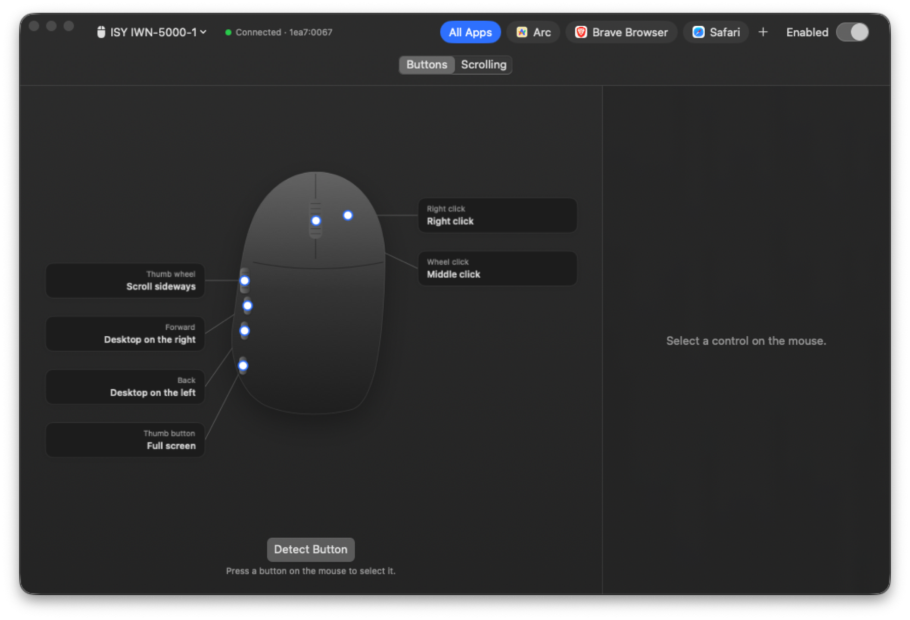

# Whisker

[](https://github.com/brgv-code/whisker/actions/workflows/ci.yml)
[](LICENSE)


Customize the buttons, wheels and gestures of any mouse on macOS, the way Logitech Options does for Logitech mice.

**Website:** [whisker.bhargav.dev](https://whisker.bhargav.dev)



Whisker started because the ISY IWM-5000-1 ships with extra buttons and a thumb wheel but no software to change what they do. It works with other mice too: if macOS sees a button, Whisker can remap it.

## What it does

- **Remap any button** to a keyboard shortcut, Mission Control, App Exposé, Show Desktop, switching desktops, back and forward, next and previous tab, full screen, media keys, another mouse button, or nothing.
- **Tap and hold.** One action on a quick press, another when you hold the button, for example back on a tap and previous tab on a hold.
- **Gesture button.** Hold a button and move the mouse up, down, left or right to run a different action for each direction. A press without moving is a click.
- **Thumb wheel.** Keep it as sideways scrolling, or turn each notch into an action (volume, switching tabs, anything above).
- **Scrolling for the mouse only.** Reverse the wheel or change its speed without touching your trackpad's Natural Scrolling.
- **Per-app settings.** Give a button a different job in a specific app.
- **Several mice.** Each mouse keeps its own settings, matched by its USB or Bluetooth ID.

Everything runs on your Mac. Whisker never writes to the mouse's own memory.

## Install

Requires macOS 15 or later, on Apple Silicon or Intel.

1. Download [Whisker.zip](https://github.com/brgv-code/whisker/releases/latest/download/Whisker.zip) and unzip it.
2. Drag Whisker.app to Applications and open it.
3. macOS says it cannot verify the developer, because Whisker is not notarized by Apple. Click Done, then go to **System Settings > Privacy & Security**, scroll down and click **Open Anyway**.

Whisker lives in the menu bar. On first launch it asks for two permissions in **System Settings > Privacy & Security**:

| Permission | Why |
|---|---|
| Accessibility | To change what buttons and wheels do. |
| Input Monitoring | To tell which mouse an event came from, so settings for one mouse never affect another. |

Some mice type keyboard shortcuts for their side buttons (the ISY sends `⌃←` for back). To catch those, Whisker looks at every keystroke and acts only on the ones the profile says came from your mouse. It records which device typed, never what was typed, and nothing leaves your Mac.

### Build from source

Requires the Xcode command line tools (`xcode-select --install`).

```sh
git clone https://github.com/brgv-code/whisker.git
cd whisker
./scripts/bundle.sh
open build/Whisker.app
```

`bundle.sh` signs with your Apple Development certificate when you have one. With ad-hoc signing macOS forgets both permissions after every rebuild, so you will need to remove and re-add Whisker in System Settings.

## Supported mice

| Mouse | Profile |
|---|---|
| ISY IWM-5000-1 (USB receiver) | [`devices/isy-iwm-5000-1.json`](devices/isy-iwm-5000-1.json) |

Any other mouse works without a profile: pick it at the top of the window, click **Detect Button**, press a button, and it appears in the window. A profile adds names, positions on the drawing, and support for buttons that send keystrokes.

## Add your mouse

Profiles live in [`devices/`](devices/), one JSON file per model:

```json
{
  "name": "ISY IWM-5000-1",
  "devices": ["1ea7:0067"],
  "buttons": [
    { "number": 3, "label": "Back", "position": { "x": 0.1, "y": 0.66 },
      "sends": { "keyCode": 123, "modifiers": ["control"] } }
  ],
  "thumbWheel": { "x": 0.1, "y": 0.46 }
}
```

- `devices`: vendor and product ID in hex, shown next to "Connected" at the top of the window. A model with a receiver and Bluetooth has two.
- `number`: the macOS button number. 1 is right click, 2 the wheel, 3 back, 4 forward. Use **Detect Button** to find the rest: a button shown as "Button 6" has number 5.
- `position`: where the hotspot sits on the drawing, 0 to 1 from the top left.
- `sends` (optional): for a button the mouse firmware turns into a keystroke. `keyCode` is the macOS virtual key code and `modifiers` any of `command`, `option`, `control`, `shift`. On Default the keystroke goes through untouched, so the mouse keeps doing what it always did. Any other action replaces it.

See [CONTRIBUTING.md](CONTRIBUTING.md) for how to find these values and open a pull request.

## Development

```sh
swift build            # compile
swift test             # engine and profile tests
swift format -i -r Sources Tests
./scripts/bundle.sh    # build the .app
```

The remapping logic lives in `Sources/WhiskerCore` and has no macOS UI dependencies, so it is fully unit tested. See [`agent_docs/service_architecture.md`](agent_docs/service_architecture.md) for how the pieces fit.

## Known limits

- Remapping happens on the Mac, so it only works while Whisker runs. DPI and polling rate live in the mouse firmware and are not supported.
- macOS does not say which mouse sent an event, so Whisker follows the mouse that moved last. Switching mice and clicking within the same instant can apply the wrong mouse's settings to that one click.
- Buttons the mouse handles internally (often the DPI button) never reach macOS and cannot be remapped.
- Tap or hold is decided when you let go, so the hold action runs on release rather than while you are still holding.
- The download is not notarized by Apple, so the first launch needs Open Anyway (see Install).

## License

[MIT](LICENSE)
